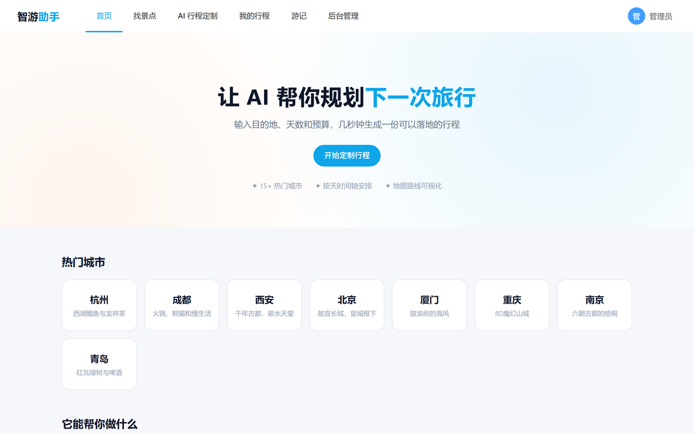
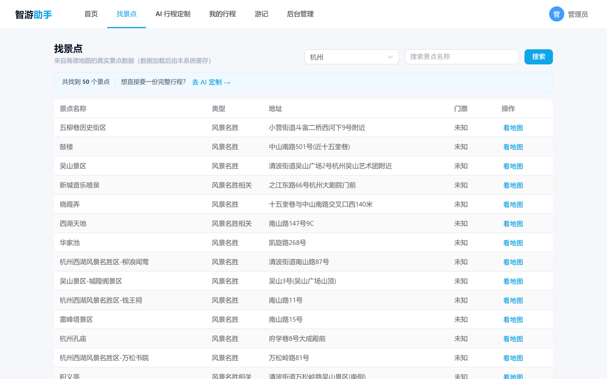
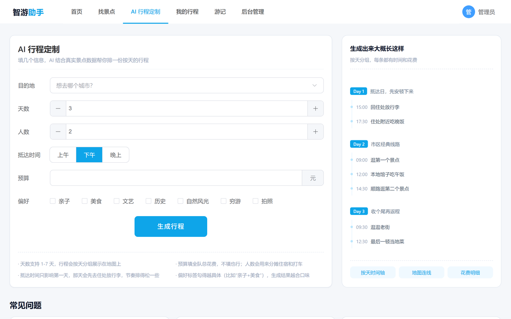
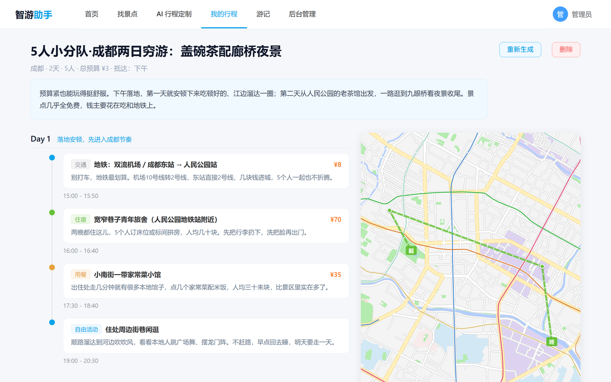
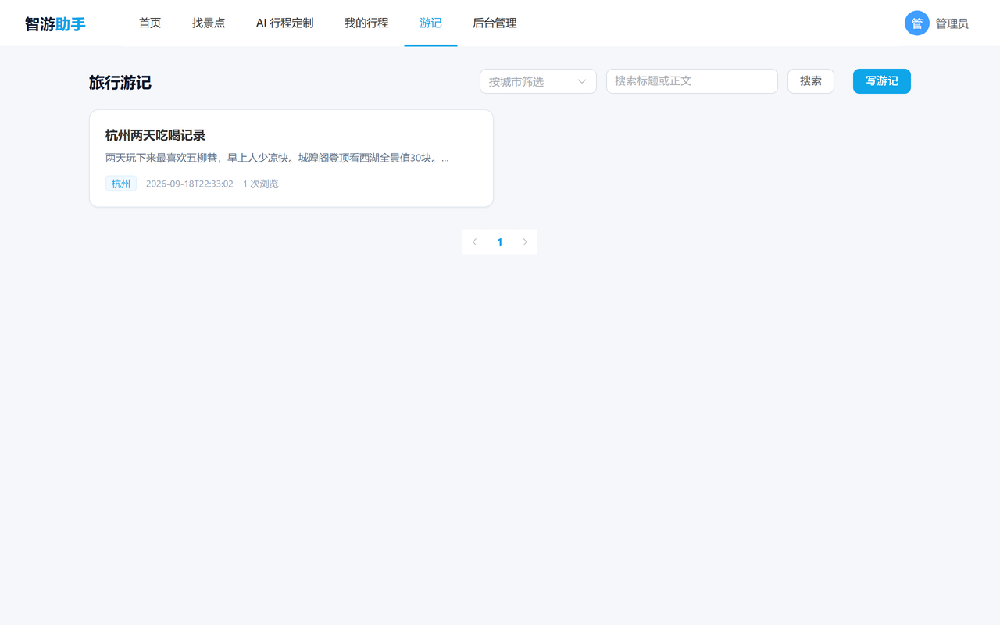
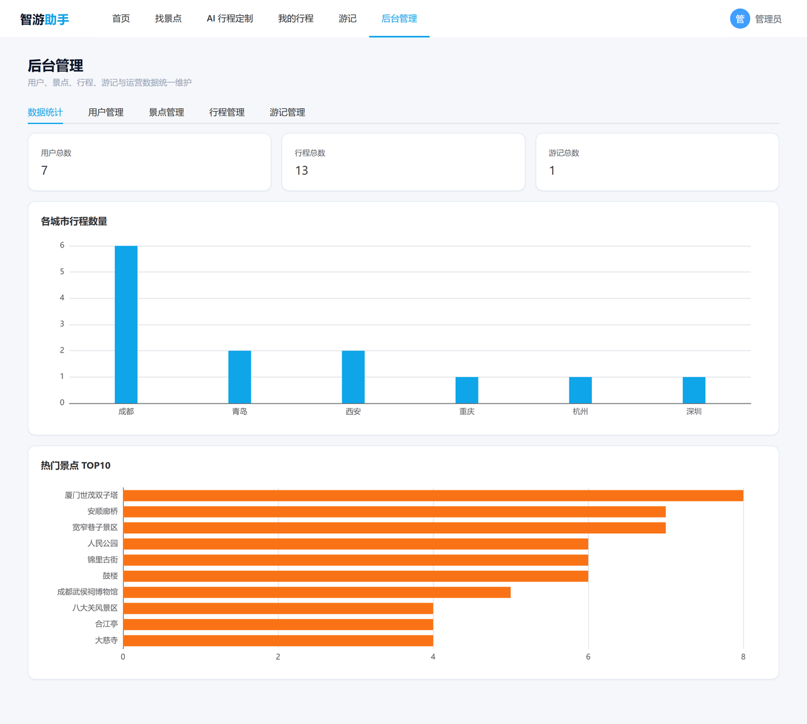
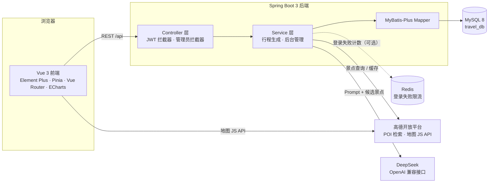

# 智游助手 · AI 行程规划系统


> 基于大语言模型的智慧文旅行程规划系统：输入目的地、天数、人数和预算，几秒钟生成一份按天安排、带地图路线和花费明细的行程。

## 项目简介

前后端分离的旅游行程规划系统。用户端完成「找景点 → AI 生成行程 → 查看行程 → 写游记」的闭环；管理端提供用户、景点、行程、游记维护和运营数据统计。

**核心思路**：生成行程前先从本地景点库（高德 POI 缓存）检索候选景点，作为白名单约束大模型，再用结构化 Prompt 要求模型输出 JSON；后端对 JSON 做解析、坐标校正和首日住宿兜底，最后落库。这样既保留大模型的规划能力，又尽量避免「编造景点、坐标乱填」的问题。

## 界面预览

| 首页 | 景点搜索 |
| :---: | :---: |
|  |  |

| AI 行程定制 | 行程详情（时间轴 + 地图） |
| :---: | :---: |
|  |  |

| 游记社区 | 后台管理 |
| :---: | :---: |
|  |  |

## 功能特性

### 用户端

- **账号体系**：注册、登录（JWT）、个人资料修改；同一用户名连续 5 次登录失败锁定 15 分钟（基于 Redis，Redis 不可用时自动降级放行）。
- **首页**：热门城市入口、平台能力介绍。
- **找景点**：按城市 / 关键词检索高德 POI，结果缓存到本地库，支持地图定位。
- **AI 行程定制**：
  - 输入目的地、1–7 天、1–10 人、抵达时段（上午 / 下午 / 晚上）、总预算、偏好标签（亲子 / 美食 / 文艺 / 历史 / 自然风光 / 穷游 / 拍照）。
  - 按天输出时间轴行程，标注景点 / 用餐 / 交通 / 住宿 / 自由活动与单人花费。
  - 行程详情页展示地图连线、每日安排和花费明细。
  - 支持「重新生成」（保留行程 ID 覆盖原内容）与删除。
- **我的行程**：查看历史生成结果。
- **游记社区**：游记列表、城市 / 关键词筛选、详情（浏览量 +1）、发布、我的游记、删除。

### 管理端

- **数据统计**：用户 / 行程 / 游记总数，各城市行程数量柱状图，热门景点 TOP10。
- **用户管理**：分页、用户名搜索、删除（不能删除自己）。
- **景点管理**：分页、城市 / 关键词筛选、新增、编辑、删除；删除时会释放高德 POI 唯一键，避免同一景点之后无法重新缓存。
- **行程管理**：全站行程分页、标题 / 城市搜索、删除（级联清理行程天与条目）。
- **游记管理**：全站游记分页、关键词 / 城市筛选、删除。

### 工程细节

- JWT 无状态鉴权，`JwtInterceptor` 统一校验，`AdminInterceptor` 对 `/api/admin/**` 二次校验管理员角色。
- 统一 `Result` 返回体与 `GlobalExceptionHandler` 全局异常处理。
- MyBatis-Plus 逻辑删除、创建 / 更新时间自动填充、分页插件。
- 高德 POI 翻页拉取 + 去重 + 城市校验 + 入库缓存；景点较少的城市只补拉一次。
- AI JSON 解析失败自动重试一次，兼容 ` ```json ` 代码块包裹。
- 坐标只信景点库：模型编造的经纬度会被清除，模糊匹配也只对「景点」类型生效。
- 首日自动补齐「先放行李」的住宿条目，并按抵达时间插入合适时段。

## 技术栈

| 层次 | 技术 |
| --- | --- |
| 后端 | Java 21、Spring Boot 3.3.5、Spring AI 1.0.0-M4、MyBatis-Plus 3.5.9、JJWT 0.12.6、Knife4j 4.5.0 |
| 前端 | Vue 3.5、Vite 8、Element Plus 2、Pinia 4、Vue Router 4、ECharts 6、Axios |
| 数据 | MySQL 8、Redis（可选） |
| 外部服务 | 高德开放平台（Web 服务 API + JS API 2.0）、DeepSeek（OpenAI 兼容接口） |

## 系统架构



**AI 行程生成流程**

1. 校验并归一化参数：天数 1–7、人数 1–10、抵达时间三档，总预算按人数摊成「人均预算」。
2. 检索候选景点：优先读本地 `scenic_spot` 缓存；数量不足时调用高德 POI（最多 2 页 × 25 条）并落库。
3. 组装 Prompt：把城市、天数、人数、人均预算、抵达时间、偏好和「名称 | 类型 | 地址 | 经纬度 | 门票」格式的候选景点列表交给模型，要求严格输出 JSON。
4. 解析与校正：最多重试 2 次；剥离 Markdown 代码块；坐标只保留候选景点库中的值；确保第一天先到住处放行李。
5. 落库：写入 `travel_plan`、`plan_day`、`plan_item`；「重新生成」复用同一套规则并覆盖原行程内容。

## 项目结构

```text
travel-planner/
├── travel-server/                     # Spring Boot 后端
│   ├── sql/
│   │   ├── init.sql                   # 建库、建表、默认管理员
│   │   └── upgrade-2026-10-08-plan-people.sql
│   └── src/main/java/com/bs/travel/
│       ├── controller/                # 用户、景点、行程、游记、后台接口
│       ├── service/                   # 业务逻辑（行程生成、后台管理、登录限流）
│       ├── ai/                        # Prompt、结果解析、坐标/首日归一化
│       ├── gaode/                     # 高德 POI 检索与缓存
│       ├── config/                    # JWT / 管理员拦截器、CORS、OpenAPI
│       ├── entity/ · mapper/          # 实体与 MyBatis-Plus Mapper
│       └── common/                    # 统一返回、异常、JWT 工具
├── travel-web/                        # Vue 3 前端
│   ├── src/views/                     # 页面（首页、景点、行程、游记、后台等）
│   ├── src/router/ · stores/          # 路由与登录状态
│   ├── src/utils/                     # Axios 封装、高德 JS API 加载
│   └── vite.config.js                 # /api 代理到 8080
└── screenshots/                       # README 界面截图
```

## 快速开始

### 1. 环境要求

| 依赖 | 版本 |
| --- | --- |
| JDK | 21 |
| Maven | 3.9+ |
| Node.js | 20.19+ / 22+ |
| MySQL | 8.x |
| Redis | 可选，用于登录失败限流 |

### 2. 初始化数据库

```bash
mysql -u root -p < travel-server/sql/init.sql
```

PowerShell 可用：

```powershell
Get-Content .\travel-server\sql\init.sql -Raw | mysql -u root -p
```

脚本会创建 `travel_db`、7 张表，并写入默认管理员 `admin / admin123`。老库升级执行 `travel-server/sql/upgrade-2026-10-08-plan-people.sql`；全新初始化不需要。

### 3. 配置后端

数据库账号密码在 `travel-server/src/main/resources/application.yml`（默认 `root / root`），按本机环境修改。

在 `travel-server/src/main/resources/application-local.yml` 配置密钥（该文件已被 `.gitignore` 忽略，不会提交）：

```yaml
spring:
  ai:
    openai:
      api-key: sk-替换为你的-DeepSeek-Key

gaode:
  web-service-key: 替换为高德 Web 服务 Key

# local 环境打开接口文档，生产环境保持关闭
springdoc:
  api-docs:
    enabled: true
  swagger-ui:
    enabled: true

knife4j:
  enable: true
  setting:
    language: zh_cn
```

> [!IMPORTANT]
> 高德「Web 服务 Key」（后端 POI 检索）和前端地图的「JS API Key」不是同一把，两个都需要申请。

### 4. 启动后端

```bash
cd travel-server
mvn spring-boot:run
```

- 服务地址：<http://localhost:8080>
- Knife4j 接口文档：<http://localhost:8080/doc.html>（仅 local profile 开启）

### 5. 配置并启动前端

```bash
cd travel-web
npm install
```

新建 `travel-web/.env.local`：

```dotenv
VITE_AMAP_KEY=替换为高德 JS API Key
VITE_AMAP_SECURITY_CODE=替换为高德 JS API 安全密钥
```

```bash
npm run dev
```

访问 <http://localhost:5173>。Vite 已把 `/api` 代理到 `http://localhost:8080`。

### 6. 登录

- 管理员：`admin / admin123`（由 `init.sql` 初始化，部署前请修改）
- 普通用户：直接在注册页注册

## 接口文档

启动后端后访问 Knife4j 页面查看完整参数与在线调试。主要接口：

| 模块 | 接口 | 说明 |
| --- | --- | --- |
| 用户 | `POST /api/user/register`、`POST /api/user/login`、`GET/PUT /api/user/info` | 注册、登录、当前用户信息 |
| 景点 | `GET /api/spot/search?city=杭州&keyword=西湖` | 高德 POI 检索并缓存 |
| 行程 | `POST /api/plan/generate`、`GET /api/plan/my`、`GET /api/plan/{id}` | 生成、列表、详情 |
| 行程 | `POST /api/plan/{id}/regenerate`、`DELETE /api/plan/{id}` | 重新生成、删除 |
| 游记 | `GET /api/note/list`、`POST /api/note`、`GET /api/note/{id}`、`DELETE /api/note/{id}`、`GET /api/note/my` | 游记列表、发布、详情、删除 |
| 后台 | `GET /api/admin/stats` | 用户 / 行程 / 游记统计、城市分布、热门景点 |
| 后台 | `GET /api/admin/user/page`、`DELETE /api/admin/user/{id}` | 用户管理 |
| 后台 | `GET/POST/PUT/DELETE /api/admin/spot...` | 景点管理 |
| 后台 | `GET /api/admin/plan/page`、`DELETE /api/admin/plan/{id}` | 行程管理 |
| 后台 | `GET /api/admin/note/page`、`DELETE /api/admin/note/{id}` | 游记管理 |

除注册、登录和接口文档外，请求都需要在 Header 中携带：

```http
Authorization: Bearer <token>
```

## 测试与构建

```bash
cd travel-server
mvn test
# 46 个单元测试：AI 结果归一化、行程业务规则、后台管理

cd ../travel-web
npm run build
```

## 配置与安全说明

- 真实密钥只放在 `application-local.yml` / `.env.local`，两者都已被 gitignore；仓库不包含任何密钥。
- `application.yml` 中的数据库密码、JWT secret 是本地演示默认值，部署前必须替换。
- 密码使用 SHA-256 + 随机盐存储（毕业设计演示方案）；生产环境建议改用 BCrypt / Argon2。
- Knife4j / springdoc 默认关闭，仅 local profile 开启，避免生产环境暴露接口文档。
- 登录失败限流依赖 Redis；Redis 不可用时自动降级，不影响登录主流程。

## 致谢

- [高德开放平台](https://lbs.amap.com/)：POI 检索与地图 JS API
- [DeepSeek](https://www.deepseek.com/)：大模型推理
- [Spring AI](https://spring.io/projects/spring-ai)、[MyBatis-Plus](https://baomidou.com/)、[Element Plus](https://element-plus.org/)、[ECharts](https://echarts.apache.org/)

---

本项目为本科毕业设计作品，主要用于学习与交流。